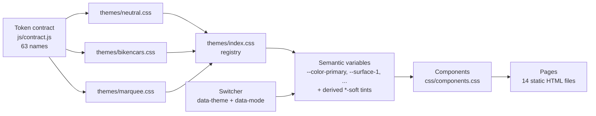

# multi-brand-design-system

A brand-neutral design system: tokens, themes, components and motion as static HTML, with bikencars shipped as one example theme.

## Demo

Live site (GitHub Pages): https://himanshumehta.github.io/multi-brand-design-system/

The same overview page in each of the three themes:

| Neutral (default, light) | Bikencars (example brand, dark) | Marquee (sample, dark) |
|---|---|---|
|  |  |  |

## Why it exists

Most design systems hard-code one brand into their components, so a second brand means a fork or a pile of overrides. This project separates the two: components read only semantic tokens, and a brand is a single CSS file that fills in those tokens for light and dark mode. It started as the design system for one automotive site (kept here as the Bikencars theme) and was reworked so any brand can drop in.

## Architecture



## Key ideas

- **A contract, not a palette.** `js/contract.js` lists 63 token names in five groups (colour, type, space, shape, motion). Every theme must define all of them; `sync-tokens.py` fails the build if one is missing.
- **Themes are attribute-scoped.** A theme applies to `[data-theme="id"]`, not `:root`, so any element can render in a different theme. The Theming page uses this to show every theme and mode side by side.
- **Dark mode overrides colour only.** Each theme has a light block with all tokens and a dark block that redefines the 23 colour tokens. Type, space, shape and motion are shared across modes.
- **No colour literals in components.** `css/` contains no hex, `rgb()` or `oklch()` values; soft tints are mixed from contract colours with `color-mix()`. `sync-tokens.py` enforces this.
- **No build step.** Plain HTML, CSS and a little vanilla JavaScript. Pages open from disk or any static host.
- **Runtime switching.** The sidebar switcher sets `data-theme` and `data-mode` on `<html>` and stores the choice in `localStorage` (wrapped in try/catch, with a query-string fallback). A head script applies it before first paint.

## Quickstart

```sh
git clone https://github.com/himanshumehta/multi-brand-design-system.git
cd multi-brand-design-system
open index.html                 # or: python3 -m http.server 8000, then visit http://localhost:8000
```

Pick a theme and light or dark mode in the sidebar. You can also link straight to a combination, for example `index.html?theme=marquee&mode=dark`.

Validate tokens (Python 3 standard library only):

```sh
python3 sync-tokens.py          # checks every theme against the contract and lints css/
python3 sync-tokens.py --json   # dumps every theme's resolved tokens
```

Load every page under every theme and mode in headless Chromium (optional):

```sh
pip install playwright && python3 -m playwright install chromium
python3 scripts/check_pages.py                # gate: console errors, empty tokens, fallback fonts
python3 scripts/check_pages.py --screenshots  # also regenerates docs/screenshot-*.png
```

## Configuration

### Theme tokens

A selection of the 63 contract tokens, as each theme defines them (`python3 sync-tokens.py --table` prints this):

| Token | Neutral light | Neutral dark | Bikencars light | Bikencars dark | Marquee light | Marquee dark |
|---|---|---|---|---|---|---|
| `--surface-0` | `#f3f4f1` | `#111312` | `#ffffff` | `#09090b` | `#f2f2ef` | `#0a0a0a` |
| `--text-1` | `#181b19` | `#eceeea` | `#111827` | `#f4f4f5` | `#141414` | `#f5f5f5` |
| `--color-primary` | `#2d47c4` | `#93a6ff` | `#4783ff` | `#4783ff` | `#7a6600` | `#e8b800` |
| `--color-accent` | `#0b7a6e` | `#4cc2b2` | `#ff6600` | `#ff6600` | `#b8960c` | `#ffd700` |
| `--font-display` | Schibsted Grotesk | Schibsted Grotesk | Inter | Inter | Bebas Neue | Bebas Neue |
| `--radius-md` | `6px` | `6px` | `10px` | `10px` | `4px` | `4px` |
| `--duration-base` | `180ms` | `180ms` | `200ms` | `200ms` | `280ms` | `280ms` |

| Group | Tokens | Per mode |
|---|---|---|
| Colour | `--surface-0..3`, `--border`, `--border-strong`, `--text-1..3`, `--text-on-primary`, `--color-primary`, `--color-primary-hover`, `--color-secondary`, `--color-accent`, `--color-success`, `--color-warning`, `--color-danger`, `--color-info`, `--focus-ring`, `--overlay`, `--shadow-1..3` | yes |
| Type | `--font-display`, `--font-body`, `--font-mono`, `--weight-regular/medium/bold/display`, `--tracking-display`, `--case-display`, `--leading-tight`, `--leading-body`, `--text-xs..4xl` | no |
| Space | `--space-1..10` | no |
| Shape | `--radius-sm/md/lg/xl/pill` | no |
| Motion | `--duration-fast/base/slow`, `--ease-standard/emphasized/spring` | no |

### Add your own theme

1. Copy `themes/neutral.css` to `themes/acme.css`. Replace `neutral` with `acme` in both selectors and drop the `:root:not([data-theme])` line (only the default theme needs it).
2. Change the values. Keep every token name; put any web-font `@import` at the top of the file.
3. Register it in `themes/index.css`: add `@import url("acme.css");` and append `,acme:Acme` to `--theme-list`.
4. Run `python3 sync-tokens.py`. It reports any missing or unknown token.

The switcher, the Theming page matrix and the token reference pick up the new theme automatically.

## Results

- 14 pages: overview, token reference, colour, typography, space and shape, motion, theming, buttons, forms, cards, tables, navigation, feedback and overlays, slides and social.
- 3 themes, each with light and dark mode: 6 combinations.
- 63 contract tokens per theme, 23 of them redefined for dark mode, plus 7 derived soft tints.
- 42 top-level component classes in `css/components.css` (`grep -oE '^\.[a-z]+(-[a-z]+)*' css/components.css | sort -u | wc -l`).
- `scripts/check_pages.py` loads all 84 page, theme and mode combinations with no console errors, no empty tokens and no fallback-font elements.

## Status, limits and licence

Status: a static reference catalogue, not a published package. There is no npm build, no component framework bindings and no versioned token export beyond `sync-tokens.py --json`.

Limits:

- Fonts load from Google Fonts. Offline, pages fall back to system fonts.
- The Bikencars theme keeps its original brand colours exactly, including white text on `#4783ff` (3.5:1), which is below WCAG AA for body-size text. The Colour page shows live contrast ratios for each theme.
- Dialogs use the native `<dialog>` element and `color-mix()`; both need a browser from 2023 or later.
- Theme switching relies on JavaScript. Without it, pages render in the Neutral light theme.

Licence: [MIT](LICENSE), copyright 2026 Himanshu Mehta.
