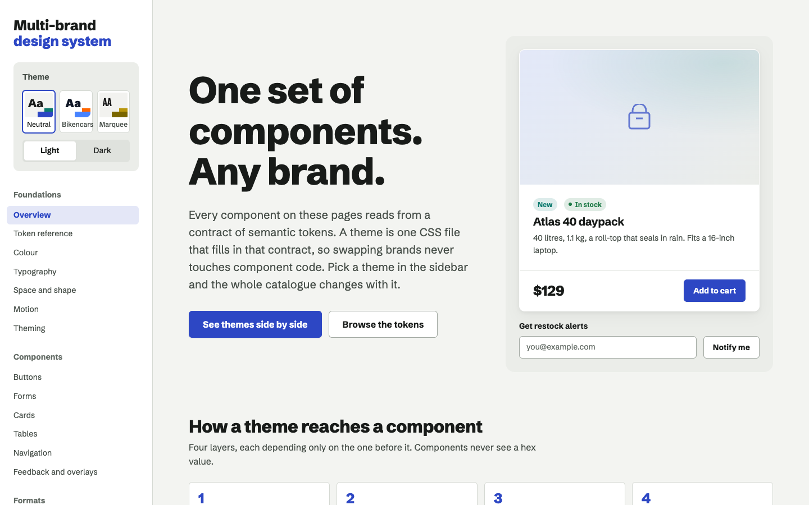
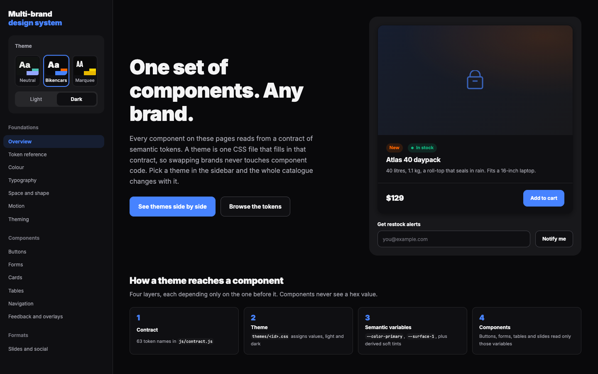
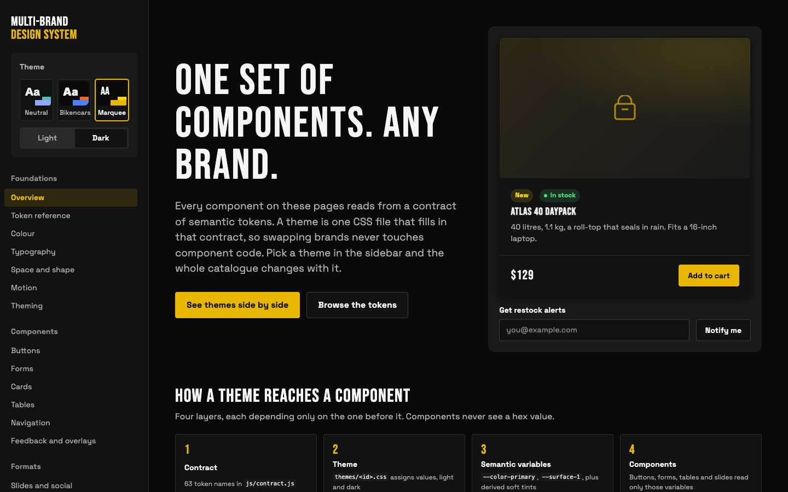
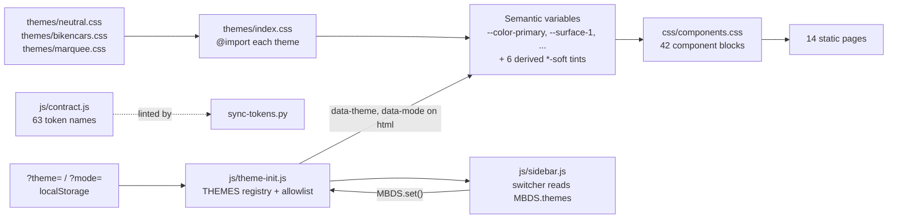
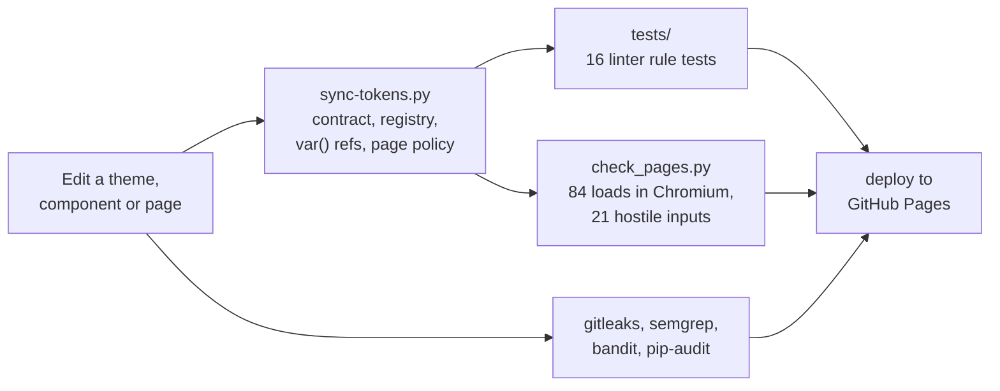

# multi-brand-design-system

A design system where a brand is one CSS file: components read only a 63-token semantic contract, and a linter plus a headless-browser gate prove every theme fills it.

[](https://github.com/himanshumehta/multi-brand-design-system/actions/workflows/pages.yml)
[](LICENSE)


## Demo

Live site (GitHub Pages): <https://himanshumehta.github.io/multi-brand-design-system/>

The same overview page in each of the three themes (captured by `scripts/check_pages.py --screenshots`):

| Neutral (default, light) | Bikencars (example brand, dark) | Marquee (sample, dark) |
|---|---|---|
|  |  |  |

Deep links pick a combination, for example `index.html?theme=marquee&mode=dark`.

## Why it exists

Most design systems hard-code one brand into their components, so a second brand means a fork or a growing pile of overrides. This one separates the two: components may reference only semantic tokens, and a brand is a single file that assigns those tokens for light and dark mode. It started as the design system for one automotive site (kept here as the Bikencars theme) and was reworked so any brand can drop in without touching component code. The constraints were: no build step, no framework, deployable to a static host, and every rule checkable by a script rather than by review.

## Architecture



A theme is a pair of rule blocks keyed on attributes, so it can apply to the whole document or to one element:

```css
[data-theme="acme"]                    { /* all 63 tokens, light */ }
[data-theme="acme"][data-mode="dark"]  { /* the 23 colour tokens again */ }
```

Verification runs at three levels before anything deploys:



| Component | Responsibility | Key file |
|---|---|---|
| Token contract | The 63 names every theme must define, in five groups; read at runtime by the token reference page and parsed by the linter | `js/contract.js` |
| Themes | Assign every token for light mode, the 23 colour tokens again for dark | `themes/<id>.css` |
| Theme registry | Theme ids and labels; the allowlist for URL and storage values; applies the choice before first paint | `js/theme-init.js` |
| Stylesheet registry | `@import` of each theme file; the only theme stylesheet a page links | `themes/index.css` |
| Catalogue chrome | Reset, layout, sidebar, derived `*-soft` tints, doc widgets | `css/catalogue.css` |
| Components | Buttons, forms, cards, tables, navigation, feedback, slides; tokens only | `css/components.css` |
| Utilities | Token specimens and layout one-offs that replace inline styles | `css/utilities.css` |
| Switcher | Builds the sidebar, theme chips (each painted in its own theme scope) and mode toggle | `js/sidebar.js` |
| Demos | Tabs, toasts, dialogs, sortable tables, live token table, contrast badges, theme matrix | `js/demo.js` |
| Linter | Contract, registry, `var()` resolution, colour-literal and page-policy rules | `sync-tokens.py` |
| Browser gate | Every page x theme x mode in Chromium; hostile inputs; interactions | `scripts/check_pages.py` |

## Design decisions and trade-offs

**The contract is a JavaScript file that a Python linter parses.**
Why: the same list drives the live token reference page in the browser and the build check, with no fetch (the CSP allows no `connect-src`) and no build step.
Trade-off: `sync-tokens.py` reads it with a regex, so the file must keep one quoted token per string. A JSON file was rejected because loading it at runtime needs a network request.

**Themes are scoped by attribute, not `:root`.**
Why: any element can carry its own `data-theme`/`data-mode`, so the Theming page renders all six combinations side by side and each switcher chip previews its own theme.
Trade-off: theme selectors carry attribute specificity, and the default theme also needs a `:root:not([data-theme])` selector so pages render without JavaScript.

**Dark mode redefines colour only.**
Why: type, space, shape and motion are brand decisions, not mode decisions; keeping them in one block halves what a theme author maintains and what the linter checks.
Trade-off: a brand that wants, say, heavier type in dark mode cannot express it within the contract.

**The theme registry lives in `theme-init.js`, not CSS.**
Why: the head script runs before any stylesheet, so it is the only place that can reject an unknown `?theme=` before first paint. Earlier versions read a `--theme-list` custom property after CSS loaded and repaired bad values after they had already been applied.
Trade-off: adding a theme touches two files (an `@import` and a `THEMES` entry). `sync-tokens.py` fails if they disagree.

**A strict CSP without `'unsafe-inline'`, set from a `<meta>`.**
Why: GitHub Pages cannot send headers, and a meta CSP is enough to block script, style and resource injection. Reaching it meant moving 95 `style=""` attributes into `css/utilities.css` and one `onsubmit` into `js/demo.js`; full-page screenshots of all 84 combinations were pixel-compared before and after.
Trade-off: 84 small utility classes, and header-only protections (`frame-ancestors`, HSTS) are not available. See [SECURITY.md](SECURITY.md).

**Soft tints are derived with `color-mix()`, not stored per theme.**
Why: six background tints follow automatically from the contract colours, so themes stay at 63 tokens and cannot drift out of sync with their base colour.
Trade-off: needs a 2023-or-later browser.

**Verification happens in a real browser.**
Why: the failure modes that matter (a token that resolves to empty, a font that falls back, a CSP violation, a theme that silently falls back) only exist after the cascade runs. `check_pages.py` reads computed styles rather than parsing CSS.
Trade-off: about a minute per run and a network connection for Google Fonts.

## Where it fits in a generation pipeline

There is no model in this repository. It is the deterministic half of a pipeline where content is generated: `python3 sync-tokens.py --json` emits every theme's resolved tokens as one document, and the two gates define what a valid theme is. A theme drafted by a person or a model is accepted only if `sync-tokens.py` passes (all 63 tokens, no unknown names, no colour literals outside `themes/`) and `check_pages.py` passes (every token resolves in the browser, fonts load, contrast ratios are printed for review).

The sibling project [data-to-video](https://github.com/himanshumehta/data-to-video) renders narrated vehicle videos from its own `design-systems/<name>/theme.json`. Its default theme uses the same Bikencars brand values as this repo's Bikencars dark theme (`#09090b` surface, `#f4f4f5` text, `#4783ff` primary, Inter). The two schemas differ (that file groups colours as `surface.1..5`, `text.1..4`, `brand`, `semantic` and adds video-only fields such as logo placement), and today the mapping between them is done by hand. An exporter from `--json` to that schema is on the roadmap below.

## Reliability and failure modes

| Situation | Behaviour |
|---|---|
| JavaScript disabled | Pages render in Neutral light (the default theme also matches `:root:not([data-theme])`); demos are inert. |
| `localStorage` blocked (private mode, sandboxed iframe) | Every access is in `try/catch`; the choice is carried across pages in the query string instead (`MBDS.persisted` is `false`). |
| Unknown or hostile `?theme=` / `?mode=` / stored value | Ignored; the next source is tried (storage, then `prefers-color-scheme`, then Neutral light). |
| Google Fonts unreachable | Each font token ends in a system fallback stack, so pages render in those fonts (metrics differ, so line lengths shift). |
| A theme misses a token | `sync-tokens.py` fails in CI; in the browser the token reference page marks the cell as missing and `check_pages.py` fails. |
| Reduced motion requested | A `prefers-reduced-motion` rule caps every animation and transition at 1 ms. |

There is no server, so operations means CI: `.github/workflows/pages.yml` runs gitleaks, the linter and its tests, the security scanners and the browser gate on every push and pull request, and deploys only when all pass.

## Accessibility

- `check_pages.py` prints four contrast ratios per theme and mode on every run. Measured in this revision:

  | Theme | Mode | text-1 / surface-0 | text-2 / surface-1 | text-3 / surface-1 | on-primary / primary |
  |---|---|---|---|---|---|
  | Neutral | light | 15.72 | 8.59 | 5.50 | 7.47 |
  | Neutral | dark | 15.98 | 8.76 | 5.79 | 7.83 |
  | Bikencars | light | 17.74 | 7.23 | 4.63 | **3.52** |
  | Bikencars | dark | 18.10 | 7.47 | **3.96** | **3.52** |
  | Marquee | light | 16.42 | 10.37 | 6.39 | 5.63 |
  | Marquee | dark | 18.16 | 8.64 | 5.57 | 10.64 |

- **Bikencars caveat.** That theme keeps the original brand colours exactly. White on `#4783ff` is 3.52:1 in both modes, and dark-mode `--text-3` on `--surface-1` is 3.96:1. Both are below WCAG AA (4.5:1) for body-size text and pass only the 3:1 large-text threshold. Neutral and Marquee are at or above 5.50:1 on all four pairs. The Colour page shows live ratios and grades for whichever theme is active.
- The switcher is two ARIA radio groups with `aria-checked`; tabs use roving `tabindex` with arrow keys; dialogs are native `<dialog>` (focus trap and Escape for free); toasts announce through a polite live region; the mobile menu closes on Escape. Focus rings use the `--focus-ring` token, so every theme defines one.

## Security

The inputs are the query string and `localStorage`; both are checked against an allowlist before they reach the DOM. No JavaScript writes HTML (Trusted Types would reject it), every page carries the same strict CSP with no `'unsafe-inline'`, and the linter fails if a page reintroduces anything the policy would block. CI actions are pinned to commit SHAs with read-only default permissions. Threat model, controls and known gaps (no response headers on GitHub Pages, no SRI for Google Fonts): [SECURITY.md](SECURITY.md).

## Quickstart

```sh
git clone https://github.com/himanshumehta/multi-brand-design-system.git
cd multi-brand-design-system
python3 -m http.server 8000          # then open http://localhost:8000/
```

Pick a theme and light or dark mode in the sidebar. Opening `index.html` straight from disk also works in Chrome; other browsers may treat `file://` differently under the CSP, so prefer the local server.

### Checks

```sh
python3 sync-tokens.py                       # contract, registry, var() refs, page policy
python3 -m unittest discover -s tests -v     # 16 tests, one per linter rule plus the real tree

python3 -m venv .venv && . .venv/bin/activate
pip install -r requirements-dev.txt && python -m playwright install chromium
python scripts/check_pages.py                # serves the repo on 127.0.0.1 itself
python scripts/check_pages.py --base-url http://localhost:8000/   # or check a running server
python scripts/check_pages.py --screenshots  # also regenerates docs/screenshot-*.png
```

`sync-tokens.py` and the tests need only the Python 3 standard library. `check_pages.py` needs Playwright (pinned in `requirements-dev.txt`); if Playwright's own Chromium is missing it falls back to an installed Google Chrome.

### Configuration

There are no environment variables. Runtime choices come from:

| Setting | Values | Default | Purpose |
|---|---|---|---|
| `?theme=` | a registered id: `neutral`, `bikencars`, `marquee` | stored choice, else `neutral` | Deep link to a theme; anything else is ignored |
| `?mode=` | `light`, `dark` | stored choice, else `prefers-color-scheme` | Deep link to a mode |
| `localStorage["mbds-theme"]`, `["mbds-mode"]` | as above | unset | Written by the switcher; validated on read |
| `sync-tokens.py --json` / `--table` | flag | off | Dump resolved tokens as JSON, or the Markdown table below |
| `check_pages.py --base-url` / `--screenshots` | URL / flag | self-served / off | Check another server; refresh the README images |

### Theme tokens

A selection of the 63 contract tokens as each theme defines them (`python3 sync-tokens.py --table`, font stacks shortened to the first family):

| Token | Neutral light | Neutral dark | Bikencars light | Bikencars dark | Marquee light | Marquee dark |
|---|---|---|---|---|---|---|
| `--surface-0` | `#f3f4f1` | `#111312` | `#ffffff` | `#09090b` | `#f2f2ef` | `#0a0a0a` |
| `--text-1` | `#181b19` | `#eceeea` | `#111827` | `#f4f4f5` | `#141414` | `#f5f5f5` |
| `--color-primary` | `#2d47c4` | `#93a6ff` | `#4783ff` | `#4783ff` | `#7a6600` | `#e8b800` |
| `--color-accent` | `#0b7a6e` | `#4cc2b2` | `#ff6600` | `#ff6600` | `#b8960c` | `#ffd700` |
| `--font-display` | Schibsted Grotesk | Schibsted Grotesk | Inter | Inter | Bebas Neue | Bebas Neue |
| `--radius-md` | `6px` | `6px` | `10px` | `10px` | `4px` | `4px` |
| `--duration-base` | `180ms` | `180ms` | `200ms` | `200ms` | `280ms` | `280ms` |

| Group | Tokens | Redefined for dark |
|---|---|---|
| Colour (23) | `--surface-0..3`, `--border`, `--border-strong`, `--text-1..3`, `--text-on-primary`, `--color-primary`, `--color-primary-hover`, `--color-secondary`, `--color-accent`, `--color-success`, `--color-warning`, `--color-danger`, `--color-info`, `--focus-ring`, `--overlay`, `--shadow-1..3` | yes |
| Type (19) | `--font-display`, `--font-body`, `--font-mono`, `--weight-regular/medium/bold/display`, `--tracking-display`, `--case-display`, `--leading-tight`, `--leading-body`, `--text-xs..4xl` | no |
| Space (10) | `--space-1..10` | no |
| Shape (5) | `--radius-sm/md/lg/xl/pill` | no |
| Motion (6) | `--duration-fast/base/slow`, `--ease-standard/emphasized/spring` | no |

### Add your own theme

1. Copy `themes/neutral.css` to `themes/acme.css`. Replace `neutral` with `acme` in both selectors and drop the `:root:not([data-theme])` line (only the default theme needs it).
2. Change the values. Keep every token name; put any web-font `@import` at the top of the file. Fonts from hosts other than Google Fonts also need adding to the CSP on every page.
3. Register it: add `@import url("acme.css");` to `themes/index.css` and `{ id: "acme", label: "Acme" }` to `THEMES` in `js/theme-init.js`.
4. Run `python3 sync-tokens.py` (reports missing, unknown or unregistered tokens and themes), then `python scripts/check_pages.py` for the browser check and contrast ratios.

The switcher, the Theming page matrix and the token reference pick up the new theme automatically.

### Testing

Measured on this revision:

| Check | What it covers | Result |
|---|---|---|
| `python3 sync-tokens.py` | 3 themes x 63 tokens (23 per dark block); `var()` resolution and colour-literal lint across 21 CSS/JS/HTML sources; page-policy lint on 14 pages | OK |
| `python3 -m unittest discover -s tests` | 16 tests: each linter rule fails on a minimal violation in a temporary copy; the real tree passes | 16 passed, about 0.3 s |
| `python scripts/check_pages.py` | 84 page loads (14 pages x 3 themes x 2 modes): no console errors, 0 CSP violations, no empty tokens, theme fonts loaded, sidebar complete. 21 hostile theme/mode inputs via URL, storage and `MBDS.set()`. Switcher persistence, demo form, confirm dialog, progress demo | OK, about 1 minute |
| semgrep `p/default` | JS, HTML, workflow YAML (491 rules across the 36 text files semgrep scans) | 0 findings |
| bandit | `sync-tokens.py`, `scripts/`, `tests/` | 0 issues |

## Project layout

```text
.
├── index.html … typography.html   14 catalogue pages
├── themes/
│   ├── index.css                  @imports every theme
│   └── neutral.css, bikencars.css, marquee.css
├── css/
│   ├── catalogue.css              chrome, layout, derived tints, doc widgets
│   ├── components.css             component styles, tokens only
│   └── utilities.css              specimens and one-offs (replaces inline styles)
├── js/
│   ├── theme-init.js              registry, allowlist, pre-paint theme
│   ├── contract.js                the 63-token contract
│   ├── sidebar.js                 navigation and switcher
│   └── demo.js                    interactive demos
├── sync-tokens.py                 linter (stdlib only)
├── scripts/check_pages.py         headless browser gate
├── tests/test_sync_tokens.py      linter rule tests
├── docs/                          README screenshots
└── .github/                       Pages workflow, dependabot, CI tool pins
```

## Limitations and roadmap

- A reference catalogue, not a package: no npm release, no framework bindings, no versioned token export beyond `sync-tokens.py --json`.
- No exporter to other token formats yet (Style Dictionary, the data-to-video `theme.json` schema, native platforms). That is the next step and would make the video templates consume these themes directly.
- Contrast is reported, not enforced; a theme can pass CI below AA, as Bikencars does by design. A per-theme threshold in `check_pages.py` would make it a gate.
- Header-based protections need a host that sets headers (see [SECURITY.md](SECURITY.md)).
- Fonts come from Google Fonts; offline, pages use the fallback stacks. Self-hosting would remove the third-party request.
- Needs a 2023-or-later browser (`color-mix()`, native `<dialog>`, container query units on the Slides page). The browser gate runs Chromium only.

## Licence

[MIT](LICENSE), copyright 2026 Himanshu Mehta.

Third-party: the themes load Schibsted Grotesk, JetBrains Mono, Inter, Bebas Neue and Space Grotesk from Google Fonts at runtime; all five are under the SIL Open Font License 1.1 and none are redistributed in this repository. The Bikencars theme reproduces that site's brand colours as a worked example.

## Author

Built by **Himanshu Mehta** — staff engineer, 10+ years building large-scale distributed systems at Outreach, Builder.ai and Twilio; now building agentic AI systems. [LinkedIn](https://www.linkedin.com/in/himanshu-mehta-29920525) · [GitHub](https://github.com/himanshumehta)

Related projects: [data-to-video](https://github.com/himanshumehta/data-to-video) · [social-publisher](https://github.com/himanshumehta/social-publisher) · [vehicle-image-studio](https://github.com/himanshumehta/vehicle-image-studio) · [multi-brand-design-system](https://github.com/himanshumehta/multi-brand-design-system)
